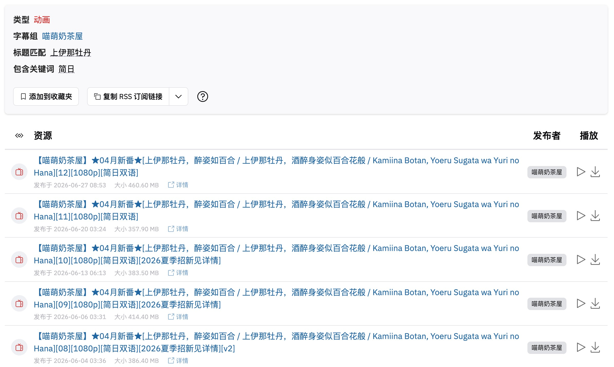

# 🌸 Anime Garden

[](https://t.me/animegarden_dev)
[](https://www.npmjs.com/package/@animegarden/client)
[](https://github.com/yjl9903/AnimeGarden/actions/workflows/ci.yml)
[](https://deepwiki.com/yjl9903/AnimeGarden)

[English](/README.en.md) | [简体中文](/README.md)

A third-party [mirror](https://animes.garden) of [動漫花園](https://share.dmhy.org/) and an [anime torrent aggregator](https://animes.garden).

+ ☁️ An open [API](https://animes.garden/docs/api) for developers
+ 📺 Browse the [anime broadcast schedule](https://animes.garden/anime) to find anime you like
+ 🔖 Advanced search with a wide range of filters, for example: `上伊那牡丹 +简日 字幕组:喵萌奶茶屋 类型:动画`
+ 📙 Custom RSS feed URLs, for example: [上伊那牡丹](https://api.animes.garden/feed.xml?subject=543360&fansub=%E5%96%B5%E8%90%8C%E5%A5%B6%E8%8C%B6%E5%B1%8B&keyword=%E7%AE%80%E6%97%A5)
+ ⭐ Bookmark search filters and generate aggregated RSS feed URLs
+ 👷‍♂️ Integrations with [AutoBangumi](https://www.autobangumi.org/) and [AnimeSpace](https://github.com/yjl9903/AnimeSpace)

> **Discussion group**: [Telegram @animegarden_dev](https://t.me/animegarden_dev)
>
> **Update channel**: [Telegram @animegarden_channel](https://t.me/animegarden_channel)
>
> **Project documentation**: [Generated by DeepWiki](https://deepwiki.com/yjl9903/AnimeGarden)

[](https://animes.garden/resources/1?subject=543360)

## Plugin Usage

Install the plugin for your Agent client.

**Codex**

```bash
codex plugin marketplace add yjl9903/AnimeGarden
codex plugin add animegarden@animegarden
```

**Claude Code**

```bash
claude plugin marketplace add yjl9903/AnimeGarden
claude plugin install animegarden@animegarden
```

After installation, start a new conversation and ask:

> Use AnimeGarden to find releases of episode 1 of 上伊那牡丹.

## Skills Usage

**Anime Garden skill**: Search for anime resources on Anime Garden.

Use the Vercel skills CLI to add the [Anime Garden skill](https://skills.sh/yjl9903/animegarden/animegarden).

```bash
npx skills add https://github.com/yjl9903/AnimeGarden --skill animegarden
```

## MCP Server Usage

Anime Garden MCP endpoint: `https://api.animes.garden/mcp`.

For example, add this entry to Claude Code's MCP configuration:

```json
{
  "mcpServers": {
    "animegarden": {
      "type": "http",
      "url": "https://api.animes.garden/mcp"
    }
  }
}
```

## Open API Usage

```bash
curl "https://api.animes.garden/resources?page=1&pageSize=10"
```

You can find the [interactive Open API documentation](https://animes.garden/docs/api) and more API examples in this repository's [examples/api.http](./examples/api.http) file.

You can also use the website to copy generated cURL, JavaScript, and Python API request code directly from a resource listing page, such as [the latest releases of 上伊那牡丹](https://animes.garden/resources/1?subject=543360&fansub=%E5%96%B5%E8%90%8C%E5%A5%B6%E8%8C%B6%E5%B1%8B&keyword=%E7%AE%80%E6%97%A5).

If you develop in JavaScript or TypeScript, you can use the npm package [@animegarden/client](https://www.npmjs.com/package/@animegarden/client), which provides a higher-level wrapper for these API requests.

## npm Package Usage

> Requires Node.js 24+ or a browser with the standard Fetch API.

A JavaScript / TypeScript API client for [AnimeGarden](https://animes.garden).

```bash
npm i @animegarden/client
```

Example:

```ts
import { fetchResources } from '@animegarden/client';

// Fetch the first page of resources
const result = await fetchResources();
if (!result.ok) {
  throw result.error;
}

console.log(result.resources);

// Fetch matching resources across pages
const botan = await fetchResources({
  count: -1,
  subject: 543360,
  fansub: '喵萌奶茶屋',
  keywords: ['简日']
});

if (!botan.ok) {
  throw botan.error;
}

console.log(botan.resources);
```

See [./examples/](https://github.com/yjl9903/AnimeGarden/blob/main/examples/) for more code examples.

Common filters (combined with AND):

| Field | Matching rule |
| --- | --- |
| `subjects` | Match any of the specified Bangumi subject IDs. |
| `fansubs` / `publishers` | Filter by fansub or publisher names, respectively. Match any name; when both are set, either condition suffices. |
| `search` | Search titles by anime name or keywords. Overrides `include`. |
| `include` | The title contains any of the specified terms; useful for searching by anime name. |
| `keywords` | The title contains every specified term, such as `['1080p', '简日']`. |
| `exclude` | Exclude resources whose titles contain any specified term. |
| `after` / `before` | Limit publication dates to an inclusive range. |

A successful `fetchResources()` result contains these fields:

| Field | Meaning |
| --- | --- |
| `ok` | `true` if the request succeeded. |
| `resources` | Matching resources, deduplicated and sorted from newest to oldest. |
| `pagination` | The last fetched page number `page` and page size `pageSize`; `complete: true` means there is no next page. |
| `filter` | The filters actually used by the server after parsing. |
| `timestamp` | The first successful response time. |

## Embedding

Copy the embed code from the resource search page and add it to your blog or other web pages.

```html
<iframe src="https://animes.garden/iframe?subject=543360" width="100%" height="600" frameborder="0"></iframe>
```

## Local Development

Follow [CONTRIBUTING.md](./CONTRIBUTING.md) to set up your environment and start developing.

## Related Projects

+ [AnimeSpace](https://github.com/yjl9903/AnimeSpace): Keep following your favourite anime
+ [anipar](https://github.com/yjl9903/AnimeGarden/tree/main/packages/anipar): Parse structure metadata from resource's title.
+ [bgmx](https://github.com/yjl9903/bgmx): Bangumi Data / API Clients

## Credits

+ [動漫花園](https://share.dmhy.org/)
+ [蜜柑计划](https://mikanani.me/)
+ [萌番组](https://bangumi.moe/)
+ [Bangumi 番组计划](https://bgm.tv/)
+ [bangumi-data](https://github.com/bangumi-data/bangumi-data)

## License

AGPL-3.0 License © 2023 [XLor](https://github.com/yjl9903)
